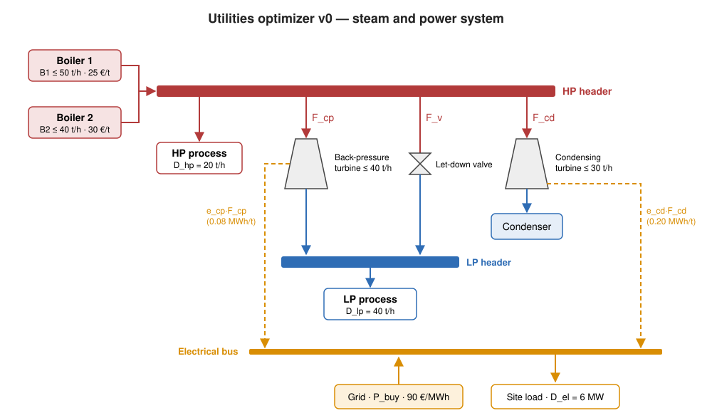
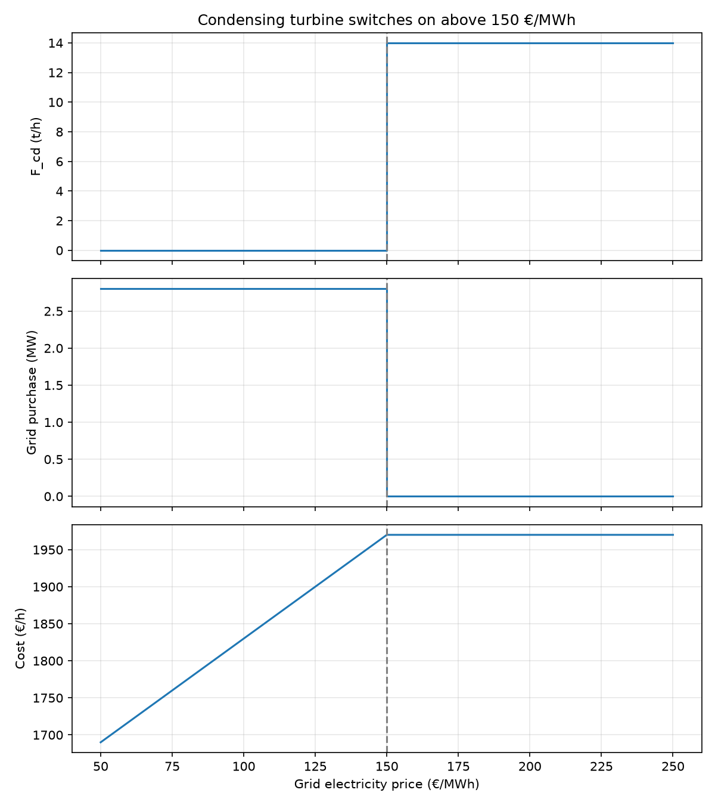

# Utilities Optimizer — steam & power

Finds the least-cost operation of an industrial steam and electricity system
(boilers, steam turbines, pressure headers, power purchase) and explains the decision.

**Status:** v0 done — minimal LP model (2 boilers, back-pressure and condensing turbines, let-down valve, one HP/LP header pair, grid purchase).



## Key findings (v0, synthetic data)

- Least-cost operation at 90 €/MWh: **1 802 €/h**. Back-pressure turbine at full load,
  let-down valve closed, 53 % of the site's power produced on site.
- The cheaper boiler is saturated; the second boiler is marginal and sets the cost of
  HP steam at **30 €/t**.
- The condensing turbine only pays off above **150 €/MWh** (= 30 €/t ÷ 0.2 MWh/t).
  Above that price it covers the remaining 2.8 MW and grid purchase drops to zero.



## Roadmap

| Version | Content | Status |
|---|---|---|
| v0 | Minimal LP, electricity price break-even, balance tests | done |
| v1 | Full HP/MP/LP site over one week, MILP (on/off, minimum load), balance tests | planned |
| v2 | Operating data in PostgreSQL, observed vs optimal operation, CUSUM | planned |
| v3 | API, small application, Docker, CI, price scenarios | planned |
| v4 | Steam demand forecast, rolling horizon | planned |

## Formulation

See [`docs/formulation.md`](docs/formulation.md).

## How to run

```bash
uv sync
uv run python -c "from utilities_optimizer.model import solve; print(solve())"
uv run pytest -v
```

## Project structure

```
src/utilities_optimizer/model.py   Pyomo model: build_model(params), solve(params)
tests/test_balances.py             Physical balances and break-even tests
docs/formulation.md                Mathematical formulation, results, interpretation
docs/system_v0.svg                 System diagram
notebooks/                         Price sweep (next)
```

Data are synthetic. No confidential plant data is used.