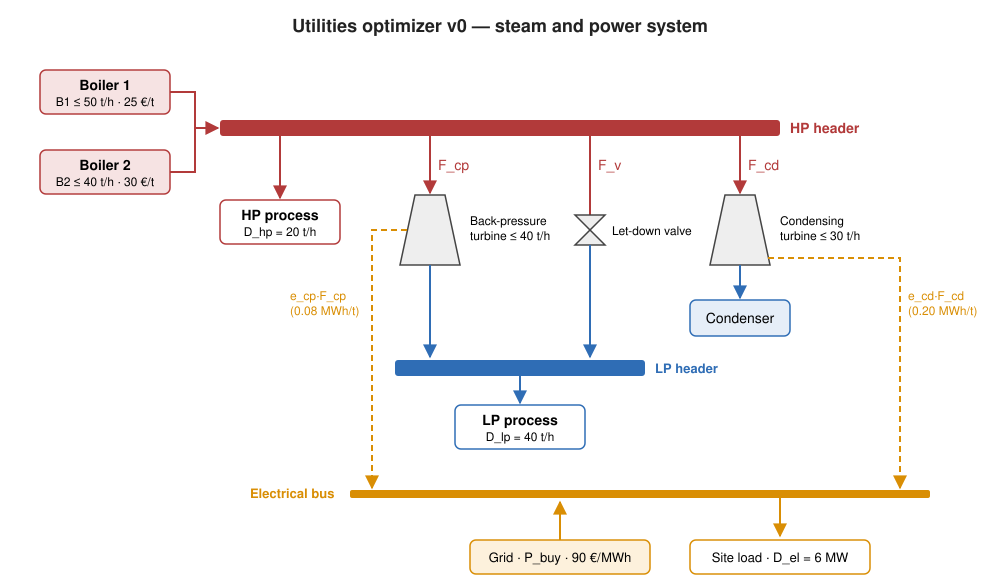

# v0 — Mathematical formulation

Minimal steady-state model of a steam and power utilities system:
two boilers, one HP header, one LP header, one back-pressure turbine,
one condensing turbine, one let-down valve, and a grid connection.
All data are synthetic.

## System



Text version:

```
            B1 ─┐
                ├─► HP header ──► HP process demand (D_hp)
            B2 ─┘      │
                       ├──► F_cp  back-pressure turbine ──► LP header ──► LP demand (D_lp)
                       ├──► F_v   let-down valve ─────────►   (LP)
                       └──► F_cd  condensing turbine ──► condenser

  Electricity: e_cp·F_cp + e_cd·F_cd + P_buy = D_el
```

## Sets and indices

None in v0 (single period, single operating point).

## Parameters

| Symbol | Meaning | Unit | Value |
|---|---|---|---|
| D_hp | HP steam demand | t/h | 20 |
| D_lp | LP steam demand | t/h | 40 |
| D_el | Electricity demand | MW | 6 |
| c_1 | Steam cost, boiler 1 | €/t | 25 |
| c_2 | Steam cost, boiler 2 | €/t | 30 |
| p | Grid electricity price | €/MWh | 90 |
| e_cp | Specific power, back-pressure turbine | MWh/t | 0.08 |
| e_cd | Specific power, condensing turbine | MWh/t | 0.20 |
| B1_max | Capacity, boiler 1 | t/h | 50 |
| B2_max | Capacity, boiler 2 | t/h | 40 |
| F_cp_max | Capacity, back-pressure turbine | t/h | 40 |
| F_cd_max | Capacity, condensing turbine | t/h | 30 |

## Decision variables

| Symbol | Meaning | Unit |
|---|---|---|
| B1, B2 | Steam produced by boilers 1 and 2 | t/h |
| F_cp | Steam through the back-pressure turbine | t/h |
| F_v | Steam through the let-down valve | t/h |
| F_cd | Steam through the condensing turbine | t/h |
| P_buy | Electricity bought from the grid | MW |

## Objective

Minimize the hourly operating cost:

$$\min \; Z = c_1 B_1 + c_2 B_2 + p \, P_{buy} \quad [€/h]$$

## Constraints

**HP header balance**

$$B_1 + B_2 = D_{hp} + F_{cp} + F_v + F_{cd}$$

**LP header balance**

$$F_{cp} + F_v = D_{lp}$$

**Electricity balance**

$$e_{cp} F_{cp} + e_{cd} F_{cd} + P_{buy} = D_{el}$$

**Capacities**

$$B_1 \le B1_{max}, \quad B_2 \le B2_{max}, \quad F_{cp} \le F_{cp,max}, \quad F_{cd} \le F_{cd,max}$$

**Non-negativity**

$$B_1, B_2, F_{cp}, F_v, F_{cd}, P_{buy} \ge 0$$

## Modelling assumptions

- Steady state, single hour, no start-up costs or minimum loads (hence LP, not MILP).
- Linear turbine performance (constant specific power e_cp, e_cd).
- No electricity export: P_buy ≥ 0.
- No losses, no deaerator, no condensate return in v0.

## Prediction (written before running the solver)

- The condensing turbine does **not** run at p = 90 €/MWh.
- Break-even price: the marginal tonne of HP steam comes from boiler 2
  (boiler 1 is already saturated), so the condensing turbine becomes
  profitable when e_cd · p > c_2, i.e. **p > 30 / 0.2 = 150 €/MWh**.

Expected solution at p = 90 €/MWh:

| Variable | Predicted | Solver |
|---|---|---|
| F_cp | | |
| F_v | | |
| F_cd | 0 | |
| B1 | | |
| B2 | | |
| P_buy | | |
| Z (€/h) | | |

## Result and interpretation

_To be completed after running `solve()`._