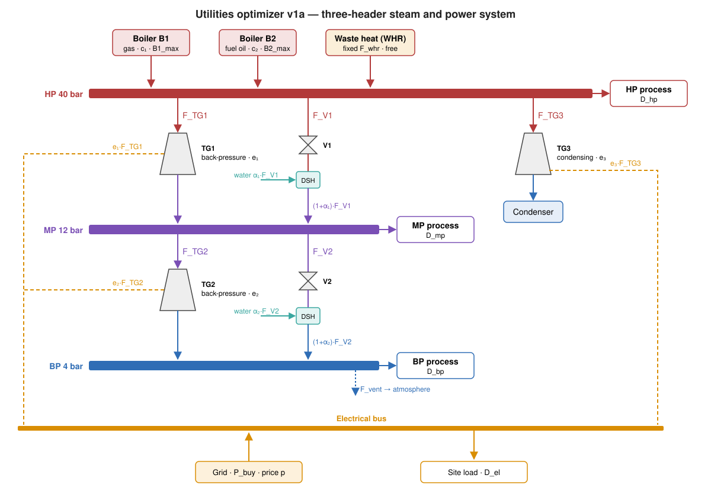

# v1a — Mathematical formulation (three-header site, single period)

v1 is built in three steps, each one tested before the next:

| Step | Adds | New difficulty |
|---|---|---|
| **v1a** | HP/MP/BP headers, 3 turbines, 2 let-down valves with desuperheaters, waste-heat steam, BP vent | network topology |
| v1b | 168 hourly periods, time-varying demands and grid price | sets and indices |
| v1c | boiler on/off, minimum load, start-up cost | binary variables (MILP) |

This document covers **v1a**: one steady-state operating point, linear program (LP).
All data are synthetic.

## System

## Parameters

Thermodynamic parameters are computed with CoolProp (see `notebooks/02_steam_parameters.ipynb`):
HP 40 bar / 400 °C, MP 12 bar / 250 °C, BP 4 bar, condenser 0.1 bar, isentropic efficiency 0.75,
desuperheating to saturation + 10 °C with feedwater at 105 °C.

| Symbol | Meaning | Unit | Default | Source |
|---|---|---|---|---|
| D_hp, D_mp, D_bp | Steam demands | t/h | 20, 40, 30 | synthetic |
| D_el | Electricity demand | MW | 12 | synthetic |
| F_whr | Waste-heat HP steam (fixed, free) | t/h | 30 | synthetic |
| c₁ | Steam cost, boiler B1 (gas 8 €/GJ, η 0.90) | €/t | 24.6 | computed |
| c₂ | Steam cost, boiler B2 (fuel oil 9.5 €/GJ, η 0.82) | €/t | 32.0 | computed |
| p | Grid electricity price | €/MWh | 90 | synthetic |
| e₁ | Specific power TG1 (HP → MP) | MWh/t | 0.065 | computed |
| e₂ | Specific power TG2 (MP → BP) | MWh/t | 0.047 | computed |
| e₃ | Specific power TG3 (HP → condenser) | MWh/t | 0.223 | computed |
| α₁ | Desuperheating water per t through V1 | t/t | 0.170 | computed |
| α₂ | Desuperheating water per t through V2 | t/t | 0.075 | computed |
| B1_max, B2_max | Boiler capacities | t/h | 80, 60 | synthetic |
| F_TG1_max, F_TG2_max, F_TG3_max | Turbine capacities | t/h | 50, 40, 30 | synthetic |

## Decision variables

| Symbol | Meaning | Unit |
|---|---|---|
| B1, B2 | Steam produced by boilers | t/h |
| F_TG1, F_TG2, F_TG3 | Steam through turbines (inlet flow) | t/h |
| F_V1, F_V2 | Steam through let-down valves (inlet flow, before desuperheating) | t/h |
| F_vent | BP steam vented to atmosphere | t/h |
| P_buy | Electricity bought from the grid | MW |

## Objective

$$\min \; Z = c_1 B_1 + c_2 B_2 + p\,P_{buy} \quad [€/h]$$

Waste-heat steam is free and does not appear in the objective.

## Constraints

**HP header**

$$B_1 + B_2 + F_{whr} = D_{hp} + F_{TG1} + F_{TG3} + F_{V1}$$

**MP header**

$$F_{TG1} + (1+\alpha_1)\,F_{V1} = D_{mp} + F_{TG2} + F_{V2}$$

**BP header**

$$F_{TG2} + (1+\alpha_2)\,F_{V2} = D_{bp} + F_{vent}$$

**Electricity**

$$e_1 F_{TG1} + e_2 F_{TG2} + e_3 F_{TG3} + P_{buy} = D_{el}$$

**Capacities**

$$B_1 \le B1_{max}, \quad B_2 \le B2_{max}, \quad F_{TG1} \le F_{TG1,max}, \quad F_{TG2} \le F_{TG2,max}, \quad F_{TG3} \le F_{TG3,max}$$

**Non-negativity**

$$B_1, B_2, F_{TG1}, F_{TG2}, F_{TG3}, F_{V1}, F_{V2}, F_{vent}, P_{buy} \ge 0$$

**Consistency check.** Every turbine and valve appears twice: leaving one header and entering
another (TG1: HP → MP, TG2: MP → BP, V1: HP → MP, V2: MP → BP). TG3 appears once, because it
exhausts to the condenser. A valve removes F from its upstream header and delivers (1 + α)·F
downstream: the desuperheating water adds mass.

## Modelling assumptions

- Steady state, single operating point; no minimum loads or start-ups (hence LP; MILP in v1c).
- Fixed thermodynamic states at each header, so specific powers e and desuperheating ratios α are
  constants and all constraints stay linear: the solver only chooses flows.
- Linear turbine performance (constant e), no part-load efficiency loss.
- Turbine exhaust is not desuperheated. In reality TG1 exhausts at about 271 °C (saturation at
  12 bar: 188 °C) and would also receive water. Ignoring it **slightly favours the valves** in v1a.
- Desuperheating water and vented steam have no cost in v1a (vented steam is still paid through
  the boilers that produced it).
- No electricity export, no losses, no deaerator, no condensate return.

## Predictions (written before solving)

1. **MP demand: TG1 or V1?** TG1 first, because it produces electricity from steam that has to be
   expanded anyway; V1 completes when TG1 is saturated.
   *Refinement:* with desuperheating, V1 delivers 1.17 t of MP per t of HP. Delivering 1 t of MP
   costs 1 t of HP through TG1 (net cost $c - e_1 p$) but only $1/(1+\alpha_1) = 0.85$ t through V1
   (cost $c/(1+\alpha_1)$). TG1 wins when

   $$p > p^* = \frac{c}{e_1}\cdot\frac{\alpha_1}{1+\alpha_1}$$

   Left side: value of the power produced by TG1. Right side: value of the HP steam saved by the
   valve (0.146 t replaced by water). With the default data, $p^* \approx 56$ €/MWh if B1 is the
   marginal boiler (24.6 €/t) and $\approx 72$ €/MWh if B2 is (32 €/t).
   **Below the threshold (cheap electricity) the valve is cheaper; above it, TG1 wins.**
2. **When is the BP vent used?** When there is excess BP steam. Two cases:
   - *forced excess* — non-dispatchable steam (waste heat, and boiler minimum loads in v1c) exceeds
     what the demands and the condensing turbine can absorb;
   - *economic excess* — at a high electricity price, with TG3 saturated, running TG1 + TG2 for power
     and venting the BP steam can be cheaper than buying from the grid.
3. **What if F_vent is removed while BP is in excess?** The header balances are strict equalities:
   no set of flows can satisfy the BP balance, so the model is **infeasible** and the solver returns
   no solution at all. Physically, the BP header pressure would rise until the safety valves open.
   A model must contain the same relief paths as the real site.
   → The code must check the solver termination condition and raise an error if it is not optimal,
   and a test must check this behaviour.

## Results and interpretation

_To be completed after running the v1a model._